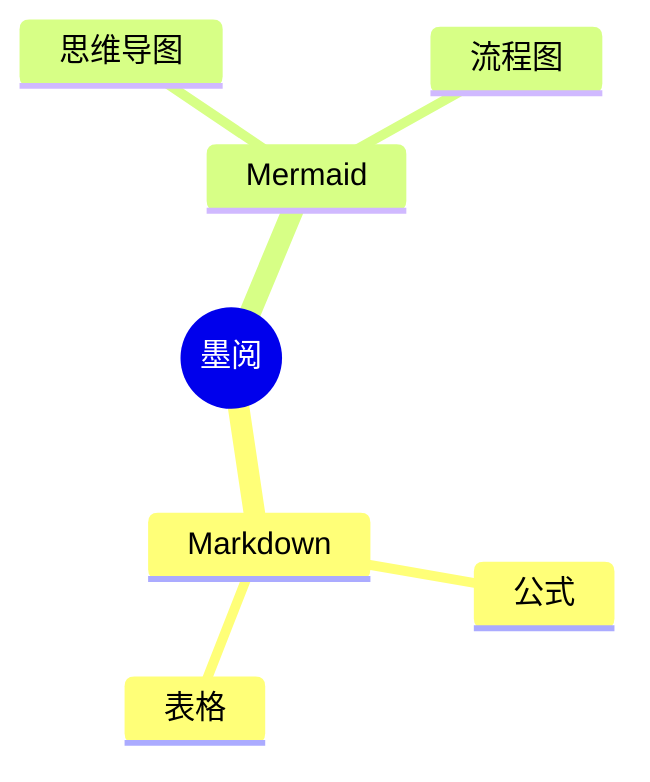

# 墨阅 MoRead

一款专注、安静的 Markdown 阅读与编辑器。纯文本存储，不锁定格式。


## 功能

- **阅读 / 分栏 / 编辑 / 可视化** 四种模式；可视化模式直接编辑排版结果，再自动转回 Markdown
- **可视化公式编辑器**：8 组符号面板、实时 KaTeX 预览、语法提示、常用模板、行内/块级切换；双击任意公式即可回到编辑器修改或删除
- **LaTeX 数学公式**：KaTeX 渲染，支持 `$...$`、`$$...$$`、`\(...\)`、`\[...\]`
- **代码块高亮**：highlight.js 覆盖 JavaScript、TypeScript、Python、HTML/CSS、JSON、Bash、PowerShell、Java、Go、Rust、C/C++、C#、SQL、YAML 等 20+ 种语言；随浅色/深色主题自动换色，带语言标签和一键复制
- **HTML 代码块预览**：`html` / `htm` 代码块可切换「预览 / 源码」，CSS 在 Shadow DOM 内隔离渲染
- **Mermaid 图表**：`mermaid` 代码块渲染成思维导图、流程图、时序图等，配色跟随主题；**双击图表或点标题栏「编辑」打开可视化编辑器**（结构树 / 源码 + 实时预览 + 独立配色），思维导图支持**发散 / 从左到右 / 从上到下**三种布局，思维导图/流程图是节点级结构编辑、其他图种是逐行结构编辑；Mermaid 按需懒加载，不拖慢启动
- **侧栏可折叠**：点左上角墨阅图标（或 `Ctrl Shift B`）展开 / 收起侧栏；最近打开、收藏夹、笔记夹、文档大纲分组也可分别收起，状态会记住；大纲按层级编号（1 / 1.1 / 1.1.1）并区分缩进与字重
- **收藏夹**：只保存文档路径，点击直接重新打开；可以「收藏当前」或「添加路径…」挑选已有文件，行内显示文件路径，悬停行尾的 `×` 取消收藏
- **笔记夹**：笔记保存为独立的 Markdown 文件（桌面在配置目录 `notes/`，Android 在应用私有目录），支持文件夹分层、重命名、分享、删除和 ZIP 导出
- **分享**：更多菜单可分享当前文档；Android 走系统分享面板，桌面复制正文到剪贴板
- **主页按钮**：文档打开时也能一键切回欢迎页或自定义主页，再点一次或按 `Ctrl Shift H` 回到文档
- **表格编辑**：在表格单元格上悬停工具条即可在光标行上/下插入、左右插入列、删除行列；源码与可视化模式都可用
- **颜色预览与取色器**：行内代码里的色值会自动显示色块；工具栏取色器支持文字颜色、文字高亮、屏幕吸管和自定义色值
- **主题工作室**：主/副强调色即时生成整套配色；**22 个组件颜色**可一键从主题色生成，也可逐项自定义；自定义软件图标、贴纸、JS 自定义按钮，以及逐项隐藏界面元素
- **自定义主页**：用 Markdown 替换欢迎页，支持图片、公式与链接
- **页面样式包**：导入 CSS 或直接粘贴，实时作用在界面上；主题包里的样式会一并应用
- **主题包库**：导入的主题保存到本地库，可装多套并随时切换；改完可覆盖更新、改名、删除；每套主题包的主页与图片独立存放
- **自定义按钮**：在右下角添加按钮并执行本地 JavaScript（可调用内置 `app` API）；首次运行会显示脚本内容并请求确认
- **插件**：`plugins/<id>/plugin.json` 声明 Markdown 自定义元素、脚本按钮、插件图标（`icon` 指向 SVG/PNG/JPEG/WebP 文件，新安装必填）和自带资源（`resources`，安装后存放在应用内部）；桌面端格式栏**每个插件一个自己的图标按钮**，点开只显示该插件的元素、脚本按钮与命令；手机端收成一个「插件」下拉按插件分组；声明了 `fields` 的元素会先弹出表单（标题/内容/颜色/下拉样式等）编辑再插入；设置 → 插件管理可安装 `.zip` 插件包、启用/停用、卸载、打开插件目录和重新扫描（重扫会重新加载入口脚本），插件列表支持按名称/作者/ID 搜索、按「全部 / 已启用 / 已停用 / 异常」筛选，每个插件可展开「详情」查看元素、按钮、命令、权限、入口与安装目录，加载失败会在列表里显示原因；插件还可以用 `commands` 在「更多」菜单里增加导入 / 导出 / 工具命令（导入组也会出现在欢迎页，没打开文档时也能导入；示例插件 `plugins/moread-office/` 提供「导入 Word 文档…」与「导出 PDF…」）；Android 版也支持插件（只能安装 `.zip` 到应用私有目录，元素/按钮/命令与桌面一致，入口脚本无 `require`、不做沙箱）；自带 `plugins/moread-sample/`、`plugins/moread-dividers/`、`plugins/moread-office/` 三个示例插件。插件是可执行本地代码的扩展，只启用可信来源
- **可视化模式完整工具栏**：插入图片、代码块、行内/块级公式、链接、表格，并支持标题、字号层级、列表、引用、任务列表、颜色与表格行/列编辑
- **文件关联**：安装包自动注册 `.md` / `.markdown` / `.mdown`，并在应用内提供默认应用设置入口
- **多标签编辑**：标签页、未保存提示、自动保存、最近文件、拖放打开；撤销/恢复在源码与可视化模式下都可用，手机格式栏改为下拉菜单后仍保留这两个按钮
- **文档大纲**：自动提取标题，点击跳转
- **导出**：HTML、PDF、纯文本
- **主题**：浅色、深色、跟随系统
- 单实例运行：双击另一个 Markdown 文件会送到已打开的窗口


## 运行

> 本工作区遵循 `Agent.md` 的约定：**未收到明确打包指令时不生成安装包**。
> 日常验证请使用开发启动脚本，不会产出或覆盖 `release/`。
> `release/` 中如已有产物，可能是历史构建，不能替代最新源码的打包验证。

开发运行：

```powershell
npm run dev
# 等价于 powershell -NoProfile -ExecutionPolicy Bypass -File scripts\start-dev.ps1
```

打开指定文件：

```powershell
powershell -NoProfile -ExecutionPolicy Bypass -File scripts\start-dev.ps1 -File "examples\示例文档.md"
```

### 安装包（需明确指令后再生成）

在收到「打包 / 生成安装包」的明确指令后执行：

```powershell
npm run dist
```

输出：

```text
release/MoRead-Setup-1.0.3.exe
release/win-unpacked/MoRead.exe
```

安装程序是**当前用户级别**的，不需要管理员权限，默认安装到：

```text
%LOCALAPPDATA%\Programs\MoRead
```

安装时会写入 Markdown 文件关联与「打开方式」注册项，并创建桌面/开始菜单快捷方式。

### 设为默认打开方式

Windows 10/11 会保护用户的默认应用选择，安装程序不会被允许静默接管已有默认项。请任选一种方式：

1. 打开墨阅，点击左下角 **.md 打开方式** → **打开默认应用设置**，在系统设置中选择 **墨阅 MoRead**。
2. 或打开 Windows **设置 → 应用 → 默认应用**，搜索 `.md` 或「墨阅 MoRead」后设为默认。

应用内会显示当前注册状态；注册完成后按钮会变成「已注册」，并引导你到系统设置完成最后一步。

### 免安装版本

打包出 `release/win-unpacked` 后可直接运行 `MoRead.exe`。如需注册文件关联：

```powershell
powershell -NoProfile -ExecutionPolicy Bypass -File scripts\register-file-association.ps1 `
  -AppPath .\release\win-unpacked\MoRead.exe
```

取消关联：

```powershell
powershell -NoProfile -ExecutionPolicy Bypass -File scripts\register-file-association.ps1 `
  -AppPath .\release\win-unpacked\MoRead.exe -Unregister
```

## Android 版（Capacitor，实验）

桌面版与 Android 版共用同一套渲染层，通过 `src/renderer/platform/` 适配 `window.moread`：Electron 走原生桥，Android 走 Capacitor 插件。已构建出可侧载的 APK：

```
release/MoRead-Android-1.1.0.apk
```

### 构建要求

| 依赖 | 版本 / 说明 |
| --- | --- |
| Node.js | 20+ |
| JDK | **21**（`JAVA_HOME` 必须指向 21；JDK 25 会报 `Unsupported class file major version 69`） |
| Android SDK | `platforms;android-36` + `build-tools;36.0.0` + `platform-tools`，并设置 `ANDROID_HOME` |
| Gradle | 使用 `android/` 自带的 wrapper（8.14.3） |

首次准备：

```powershell
npm install
npx cap add android        # 已生成过则跳过
```

日常构建：

```powershell
npm run android:sync       # build 渲染层 + cap sync + 清理 sourcemap
npm run android:build      # debug APK
npm run android:release    # 签名 release APK
```

产物：`android/app/build/outputs/apk/release/app-release.apk`（`npm run android:release` 会按 `build.gradle` 的 versionName 复制到 `release/MoRead-Android-<版本>.apk`）。

### ADB 调试

连接手机并打开 USB 调试后：

```powershell
npm run android:debug      # cap sync + debug APK + adb install + 启动 + 转发 WebView 调试端口
```

脚本会设置 JDK 21 / Android SDK，安装 `app-debug.apk`，把调试版启动起来，并把 WebView 的 devtools socket 转发到 `9333`。设备需要保持解锁和亮屏（脚本会尝试唤醒并关闭锁屏，但不会绕过 PIN）。随后访问 `http://127.0.0.1:9333/json`，或在 Chrome 的 `chrome://inspect` 里添加 `127.0.0.1:9333`。

只重新安装已有的 debug APK：

```powershell
powershell -NoProfile -ExecutionPolicy Bypass -File scripts\android-debug.ps1 -SkipBuild
```

### 签名

`android/keystore.properties` 与 `android/moread-release.jks` 是本机自签名材料，已在 `android/.gitignore` 中忽略。**正式发布请替换成你自己的 keystore 并妥善备份**；上架 Google Play 还需要 AAB 与隐私政策。

### 打开方式与系统集成

- 安装后系统「打开方式」里会出现墨阅：已注册 `.md` / `.markdown` / `.mdown` / `.txt`（含 `application/octet-stream` 的文件管理器兼容路径）。
- **主题包可直接双击打开**：点击 `.zip` 主题包（或从文件管理器「分享到墨阅」）会直接进入主题包导入确认，不需要在应用里选文件。
- **保存有三层兜底**：能写就原地保存；文件是别处打开（只读授权）就自动「另存为」并提示已存副本；系统「另存为」对话框不可用（部分 HarmonyOS 兼容层）时，写入应用私有目录并弹出分享面板，让你存到「文件」或云盘。
- 部分设备/兼容层（如 HarmonyOS NEXT 的 Android 转译环境）无法弹出系统文档选择器：此时应用会自动回退到 WebView 的文件选择；如果连这个也不可用，直接用文件管理器打开 `.zip` 即可导入主题。
- 状态栏、导航栏颜色跟随当前主题，避免上下白边。

### Android 端差异

| 能力 | 状态 |
| --- | --- |
| Markdown 阅读 / 编辑 / 可视化、大纲、搜索 | ✅ |
| KaTeX 公式、代码高亮、表格、HTML 预览 | ✅ |
| Mermaid 图表 + 可视化编辑器（结构树 / 源码 / 配色主题） | ✅ 上下分栏，触屏按钮加大 |
| 主题工作室、组件颜色、贴纸、自定义按钮（JS） | ✅ |
| 主题包 ZIP（含主页/CSS/图片）、CSS 样式包、自定义主页 | ✅（通过应用私有目录 + `file://` 转换） |
| 插件（自定义元素 / 脚本按钮 / 安装卸载 / 热重载） | ❌ 桌面端专属；Android 适配层没有插件桥，设置里会显示不可用 |
| 打开 / 保存 / 另存为 | ✅ 通过系统 SAF 文件选择器；最近文件依赖持久 URI 授权 |
| 导出 HTML / 纯文本 | ✅ 走 SAF |
| 导出 PDF | ✅ 走 Android 系统打印 |
| 收藏夹 / 笔记夹 | ✅ 收藏存路径；笔记写到应用私有目录 `files/notes/*.md` |
| 分享当前文档 / 笔记 | ✅ 系统分享面板（FileProvider）；文本分享走 Capacitor Share |
| ADB / WebView 调试 | ✅ `npm run android:debug`（JDK 21 + adb + 9333 端口转发） |
| 插入图片 | ⚠️ 以 data URL 内嵌，单张上限 300 KB |
| 文档内相对路径图片 | ⚠️ SAF 不提供目录权限，建议用 https 图片 |
| 窗口图标、注册表关联、拖拽导入 | ❌ 桌面专属 |
| 手机窄屏布局 | ✅ 一屏宽（无横向溢出）、格式栏收成几个下拉菜单、标题栏次要入口收进「更多」、≥620px 侧栏并排 / 更窄变抽屉、状态栏精简、系统栏安全区适配 |
| Android「打开方式」打开 `.md` / `.zip` | ✅ Manifest 已声明 `ACTION_VIEW` / `ACTION_SEND` |

数据保存在应用私有目录（`files/theme-assets`、`files/notes` 等），卸载会清除；没有桌面端的注册表/默认应用概念，安装后由系统「打开方式」选择墨阅。

移植过程中踩过的坑（工具链、SAF 授权、大文件 Base64、兼容层）整理在 **[移动端打包踩坑记录](docs/移动端打包踩坑记录.md)**。

> 已在真机（Android 17）验证启动、打开文档、阅读/编辑切换、侧栏抽屉、设置弹窗与系统栏安全区；首次安装仍建议先打开一篇示例文档确认。

## 快捷键

| 操作 | 快捷键 |
| --- | --- |
| 新建 / 打开 / 保存 | `Ctrl N` / `Ctrl O` / `Ctrl S` |
| 另存为 | `Ctrl Shift S` |
| 关闭标签 | `Ctrl W` |
| 查找 | `Ctrl F` |
| 加粗 / 斜体 | `Ctrl B` / `Ctrl I` |
| 链接 / 行内代码 | `Ctrl K` / `` Ctrl ` `` |
| 阅读 / 分栏 / 编辑 | `Ctrl 1` / `Ctrl 2` / `Ctrl 3` |
| 可视化编辑 | `Ctrl 4` |
| 公式编辑器 | `Ctrl Shift M` |
| 主题工作室 / 设置 | `Ctrl Shift ,` / `Ctrl ,` |
| 收起侧栏 | `Ctrl Shift B` |
| 显示主页 | `Ctrl Shift H` |
| 放大 / 缩小字号 | `Ctrl +` / `Ctrl -` |
| 导出 PDF | `Ctrl P` |

## 可视化公式编辑器


`Ctrl Shift M`、工具栏的 ∑ 按钮，或**双击文档里的任意公式**，都会打开公式编辑器：

- 左侧 8 组符号面板：结构、基础、希腊、关系、箭头、运算、环境、字体，点一下就插入到光标处，并自动把光标停在 `{}` 里
- 中间实时预览，KaTeX 语法错误会在预览下方给出中文提示，不会打断输入
- 源码框可以直接粘贴已有 LaTeX，也能用 12 个常用模板快速起步
- 「行内 / 独立公式」切换决定插入 `$...$` 还是 `$$...$$`
- 编辑已有公式时会自动定位到源码中的那一条，可保存或删除；可视化模式下同样有效

## 可视化编辑


在「可视化」模式下直接编辑渲染结果；段落、标题、列表、表格、代码块、公式与颜色都可在退出时转回 Markdown。公式和 HTML 预览块保持只读，避免误改结构；图表、公式、代码块、表格后面会留出可点击的空行，光标可以落在它们之后继续输入。

## 侧栏、大纲与最近打开


- **开合方式**：点左上角墨阅图标收起 / 展开侧栏（`Ctrl Shift B` 同样有效）；窄屏只在放不下时变成抽屉（≥620px 仍并排），点左上角图标打开、点内容区关闭
- **可收起**：「最近打开」「收藏夹」「笔记夹」「文档大纲」的分组标题可点击折叠，状态会记住，下次打开保持原样
- **收藏夹（路径）**：只记录文档路径，点击打开原文件；「收藏当前」或「添加路径…」都可以添加，行内同时显示文件名与路径，行尾 `×` 取消收藏
- **笔记夹（文件）**：新建笔记会生成真实 `.md` 文件；文件夹可嵌套（文件夹「⋯」→ 新建子文件夹），笔记支持打开、重命名、分享、删除；「导出 ZIP」按文件夹结构导出全部笔记
- **分享**：更多菜单里的「分享当前文档」在 Android 打开系统分享面板，在桌面复制正文到剪贴板；笔记行尾菜单也可以分享单篇笔记
- **层级编号**：大纲按标题层级自动编号（`1` / `1.1` / `1.1.1`），不同级有各自的缩进、字号与字重，深色下同样清晰
- **逐级折叠**：大纲里每个有子标题的层级前都有下拉箭头，可单独展开 / 收起它的下一级，互不影响；折叠状态按文档记住。「文档大纲」标题下方还有「展开全部 / 收起全部」，一次调整所有层级
- 当前 6 级以内标题参与编号，超过 6 级仍显示但并入第 6 级缩进

## 主题工作室


右上角调色板按钮打开主题工作室：

- **色彩**：设置主/副强调色，实时生成按钮、链接、选中态和背景色阶；内置 6 套快速配色
- **主页**：用 Markdown 替换欢迎页内容，可插入图片、公式和链接
- **样式**：导入一份 CSS 样式包，或直接粘贴 CSS，实时作用到界面上
- **图标**：切换内置图标或上传 PNG/JPG/WebP；同步更新标题栏与当前窗口图标
- **贴纸**：添加 emoji 或图片贴纸，可拖动位置、调整大小/角度/显示范围
- **按钮**：添加执行本地 JavaScript 的按钮，显示在右下角；内置 `app` API 可插入文本、打开/保存、切换主题等
- **主题包**：把整套主题（含主页、CSS 与图片）导出成 `.zip`，或导入别人分享的主题包
- **界面**：逐项显示/隐藏顶栏、侧栏、大纲、状态栏、代码复制、颜色块等界面元素

### 组件颜色


22 个组件颜色既可以逐项覆盖，也可以点「从主题色生成」由主/副强调色一次生成：

应用背景、标题栏、侧栏、工作区、编辑器背景、阅读纸张、纸张浮层、状态栏、正文文字、次要文字、辅助文字、弱化文字、分隔线、轻分隔线、代码背景、代码文字、代码标题栏、表头背景、引用背景、选中背景、图表主色、图表辅色。

生成模式下切换浅色/深色会自动重算；单独修改某个组件后，其余颜色保持不变并转为自定义；「全部继承」回到 CSS 默认。

### 主页内容


「主页」页签里写 Markdown，就会替换掉默认欢迎页；关闭开关或清空内容即恢复默认主页。


- 支持完整 Markdown：标题、列表、图片、表格、公式、代码块
- 「插入图片」会把图片复制到墨阅的主题资源目录，导出主题包时一起打包
- 导入的主题包可以自带 `home.md` 与 `assets/` 图片，包内相对路径 `assets/xxx.png` 会自动解析（不用手写 `file://`）

### 页面样式包


「样式」页签可以直接编辑 CSS，或点「导入 CSS 文件」选择一份 `.css`：

- 样式插在页面最后，优先级高于内置样式，适合改圆角、阴影、间距、隐藏某些元素
- 主题包里的 `style.css` 会一并导入，`url(assets/xxx.png)` 会自动改写成可用的本地地址
- 受 CSP 限制，`@import` 远程样式与远程字体会被拦截；CSS 只能影响外观，不会执行脚本
- 只导入可信来源的样式：CSS 可以隐藏按钮、遮挡界面

### 主题包库


主题包是一个 **ZIP**，导入后会**存进本地主题包库**，不再直接覆盖当前主题就算完：

```
my-theme.moread-theme.zip
├── theme.json      # 配色、组件颜色、图标、贴纸、按钮、界面隐藏、home/style 开关
├── style.css       # 可选：页面样式包
├── home.md         # 可选：自定义主页 Markdown
└── assets/         # 可选：主页图片、CSS 背景图等
```

- **可以装很多套**：导入的每个主题包都是库里的一条记录，各自拥有独立的图片目录（`theme-assets/packs/<id>/assets`），互不覆盖
- **自由切换**：列表里点「切换」立即应用；当前在用的会标「当前使用」，切换只影响外观，不改文档
- **编辑后覆盖更新**：应用某个主题包后继续在工作室里改配色、主页、CSS，列表会出现「保存修改」，一键写回这套主题包
- **改名 / 删除**：改名只改显示名；删除会连同它自己的图片目录一起清理，删的不是当前主题时界面不变
- **把当前主题存为新的主题包**：从零调好一套配色后，直接存进库，方便以后切回来
- **导出某套主题包**：每行都有「导出」，导出的是那一套自己的配色、主页、CSS 与图片，不影响当前主题
- **从剪贴板导入**：把 `theme.json` 内容复制到聊天工具分享；剪贴板方式不包含图片文件
- **拖入窗口**：把主题包 zip、主题 JSON 或 `.css` 直接拖进窗口即可导入
- **命令行**：`moread --import-theme="D:\path\my-theme.moread-theme.zip"` 启动时直接导入
- **Android**：在文件管理器里点击 `.zip`，或「分享到墨阅」，会直接导入并切换

`theme.json` 结构（版本 2，省略了部分字段）：

```json
{
  "format": "moread-theme",
  "version": 2,
  "name": "我的墨阅主题",
  "home": { "enabled": true },
  "style": { "enabled": true },
  "theme": {
    "mode": "light",
    "primary": "#c4562d",
    "secondary": "#b4873b",
    "componentColors": { "appBg": "#f0e8de" },
    "brandIcon": { "type": "preset", "value": "default" },
    "stickers": [],
    "customButtons": [],
    "uiHidden": []
  }
}
```

导入时会对颜色、图标、贴纸数量、CSS 长度与脚本长度做校验；主题包可以携带脚本按钮，导入时会单独确认（可以「仅导入外观」跳过按钮），脚本按钮第一次运行还会显示来源与脚本内容再确认。自定义按钮的 JavaScript 与 CSS 也来自主题包，因此只导入可信来源。

想自己做一个主题包？字段、限制、完整示例和排错清单见 **[主题包制作指导](docs/主题包制作指导.md)**。

## 表格编辑

把鼠标移到表格上会出现「↑行 / ↓行 / −行 / ←列 / →列 / −列」工具条。先点击单元格或在源码中定位光标，再在上方/下方插入行、在左侧/右侧插入列，或删除光标所在的行/列。表头行不会被删除，最后一列也不会被删空。源码模式会直接改写 Markdown，表格在可视化模式下则通过内容模型往返转换。

## Markdown 扩展

### 数学公式


```markdown
行内：$E = mc^2$，或者 \(a^2 + b^2 = c^2\)。

$$
\int_{-\infty}^{\infty} e^{-x^2}\,dx = \sqrt{\pi}
$$
```

### HTML 预览


````markdown
```html
<div class="note-card">
  <h3>一块 HTML 卡片</h3>
  <p>支持 <strong>静态 HTML</strong> 与 CSS。</p>
</div>
<style>
  .note-card { border: 1px solid #d9cbb4; padding: 16px; }
</style>
```
````

HTML/`htm` 代码块可以切换「预览 / 源码」。预览在 Shadow DOM 内隔离渲染，不执行脚本。

### Mermaid 图表


````markdown

````

- 支持 Mermaid 的全部图种：`mindmap`、`flowchart`、`sequenceDiagram`、`classDiagram`、`gantt`、`pie` 等
- 思维导图可切换**发散 / 从左到右 / 从上到下**三种布局（布局写在源码注释里，跟着文档走）
- 图表配色由当前主题色推导（主强调色 → 分支色阶），切换浅色/深色或换主题色时自动重绘
- 标题栏的「源码」可展开原始代码，「复制」复制源码；**双击图表**打开可视化编辑器
- 渲染结果按「源码 + 配色 + 布局」缓存，滚动和重新排版不会重复渲染
- Mermaid 体积约 5 MB，打包为 `dist/vendor/mermaid.min.js` 并在文档里出现图表时**按需加载**，没有图表就不加载
- 语法错误会在图表位置显示错误原因并自动展开源码，方便就地修改

### 图表可视化编辑器


双击任意图表（或点图表标题栏的「编辑」，或从「插入 → Mermaid 图表」新建）会打开编辑器：

- **三种布局**：发散（Mermaid 原生思维导图）、从左到右、从上到下。后两种把同一棵树按流程图方向渲染，源码仍然是 `mindmap`，结构编辑照常可用
- **结构面板**：思维导图以可编辑树呈现——点行选中，`＋子项` `＋同级` `← 提升` `降级 →` `上移` `下移` `删除`；`形状` 下拉可给选中节点换圆形/方形/圆角/六边形
- **键盘**：在节点输入框里按 `Enter` 加同级、`Tab` 加子项、`Shift+Tab` 提升一级
- **流程图**：节点与连线都能编辑——节点可改文字、形状（矩形/圆角/菱形/胶囊/六边形），连线可直接换起点/终点、改连线文字；点「＋ 连线」弹出连线表单（起点 → 终点 + 文字），「＋ 节点」先加节点再接线
- **源码面板**：直接改 Mermaid 源码，结构面板同步刷新
- **其他图种**：时序图 / 类图 / 状态图 / 饼图 / 甘特图 / 旅程图 / ER 图也有「结构」面板，以逐行语句编辑（增删、上移下移、实时预览）；复杂语法仍可切到源码
- **实时预览**：右侧即时渲染，语法错误在下方给出原文提示
- 编辑已有图表时保存会**替换原来那个代码块**（用源码行号定位，同一文档里多个相同图表也不会改错）；可视化模式下同样适用
- 手机上是上下布局：上方结构/源码，下方预览，按钮加大到触屏尺寸

节点级结构编辑只覆盖「能被可靠解析」的部分：思维导图需单根节点，流程图不支持子图、`classDef`、链式连线；其他图种使用逐行结构编辑，复杂语法切到源码编辑，**不会**把图表改坏。


流程图的「结构」面板分三段：

1. **方向**：LR / TD / RL / BT
2. **节点**：每行可改文字、形状，`✕` 删除（连带删掉它的连线）
3. **连线**：每行两个下拉就是起点/终点，可直接改；右侧输入框填连线文字，`✕` 删除这条线

底部「＋ 节点」新增一个孤立节点，「＋ 连线」展开表单：选起点、终点、填文字后「添加」（也可以在文字框里回车）。孤立节点会以单独一行出现在图里，接上线即可。

### 图表配色主题


编辑器右上角有「跟随主题 / 自定义」两个选项，配色直接来自主题系统：

- 跟随主题（默认）：使用主题里的 `图表主色 / 图表辅色`（组件颜色 → 图表），换主题包、切深浅色都会自动重算
- 自定义：只给这一张图换主/辅两个颜色，写成源码注释
- 配色与布局会合并成一行注释：`%% moread:mindmap theme=moss layout=tree`，跟着 Markdown 文件走，换电脑、分享给别人都保留
- 其他 Mermaid 渲染器会把它当普通注释忽略，仍然正常出图
- 覆盖到所有图表类型（不只是思维导图），流程图同样能选配色

### 颜色


工具栏取色器会在选区外包裹安全的行内 HTML：

```html
<span style="color:#C4562D">朱砂色的句子</span>
<mark style="background-color:#F3D9CA">温暖的底色</mark>
```

预览会自动为行内代码中的 `#C4562D`、`rgb(...)`、`hsl(...)` 显示色块，点击可复制色值。

### 代码

````markdown
```javascript
const greeting = "你好，墨阅";
```
````

## 开发

需要 Node.js 20+。

```powershell
npm install
npm run dev        # 只构建并启动开发版（推荐）
npm run build      # 只构建 dist 资源
```

打包命令（需明确指令）：

```powershell
npm run pack       # 生成免安装目录 release/win-unpacked
npm run dist       # 生成 NSIS 安装包
```

技术栈：Electron + CodeMirror 6 + markdown-it + KaTeX + highlight.js + DOMPurify + Turndown。

## 文档

| 文档 | 内容 |
| --- | --- |
| [文档导航](docs/README.md) | 哪份文档该读、该改，以及文档一致性检查清单 |
| [介绍](docs/介绍.md) | 墨阅是什么、能做什么、数据与隐私、上手三步 |
| [使用指南](docs/使用指南.md) | 打开保存、视图、公式图表、主题、插件、笔记夹、导出与快捷键 |
| [项目说明（交接文档）](docs/项目说明.md) | 架构、目录、数据模型、构建打包、约定与坑、验证方法；换人/换对话接手先读它 |
| [插件制作指导](插件制作指导.md) | 插件目录、`plugin.json`、自定义元素、脚本按钮、菜单命令（导入/导出/工具）、Android 与调试 |
| [主题包制作指导](docs/主题包制作指导.md) | 主题包字段、示例、排错 |
| [GitHub Wiki 源文件](docs/wiki/README.md) | 介绍 / 使用指南 / 主题包 / 插件的**中英双语** wiki 页面与上传说明 |
| [移动端打包踩坑记录](docs/移动端打包踩坑记录.md) | 工具链、SAF 授权、大文件 Base64、兼容层 |
| [变更记录](IMPLEMENTATION_NOTES.md) | 按轮次的实现与修复记录（最新在最后） |
| [Agent.md](Agent.md) | 给 Agent 的硬性规则（未授权不打包、编码纪律、架构约定） |

> 首次启动时，**介绍、使用指南、插件制作指导、主题包制作指导** 会自动放进「笔记夹」；之后可自由编辑或删除。

## 说明

- 安装包未做代码签名，首次运行时 Windows SmartScreen 可能提示「更多信息 → 仍要运行」。
- 所有文档都以原始 Markdown/文本保存，不写入私有格式。
- 不收集遥测；设置保存在 `%APPDATA%\MoRead\settings.json`。
- 自定义按钮与插件按钮会在当前窗口执行脚本；第一次运行会显示来源和脚本内容并请求确认，可记住信任。为确保脚本功能，渲染进程启用了 `unsafe-eval`，这是有意的本地扩展能力，不是远程代码执行入口。
- 自定义主页与样式包只影响外观与欢迎页内容，不执行脚本；但 CSS 可以隐藏或遮挡界面元素，导入陌生主题包前请确认来源。
- 主题包解压后的图片保存在 `%APPDATA%\MoRead\theme-assets\`，不会写入文档目录。
- HTML 代码块预览只渲染静态 HTML/CSS，不执行脚本。
- 如果编辑的是外部程序正在写入的文件，请使用「更多 → 从磁盘重新载入」。

## License

GNU General Public License v3.0（GPL-3.0），全文见 [`LICENSE`](LICENSE)。
