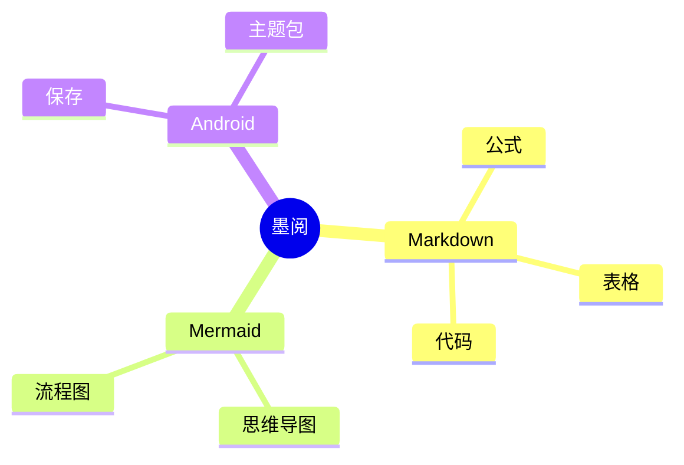
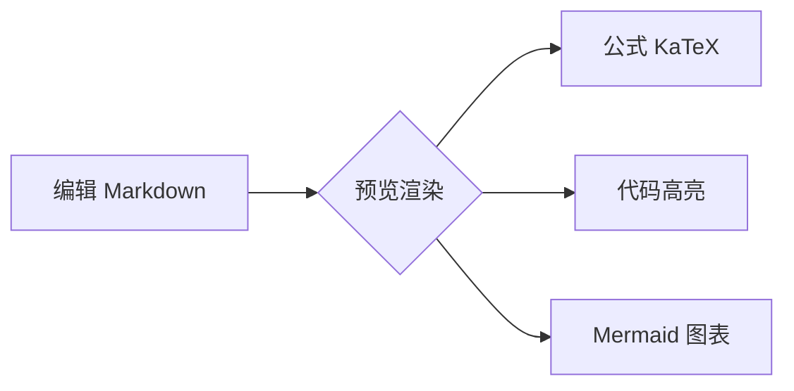

# 欢迎使用墨阅

> 一款安静、专注的 Markdown 阅读与编辑器。  
> 公式、代码、颜色，都在这张纸上。

---

## 快速开始

- **打开**：`Ctrl + O`，或把 `.md` 文件拖进窗口
- **保存**：`Ctrl + S`
- **切换模式**：`Ctrl + 1` 阅读 · `Ctrl + 2` 分栏 · `Ctrl + 3` 编辑
- **颜色**：选中文字，点击工具栏的色点

### 任务列表

- [x] 支持 KaTeX 数学公式
- [x] 代码块语法高亮
- [ ] 把 `.md` 设为默认打开方式
- [ ] 写下今天的第一行

## 数学公式

> 双击任意公式，或按 `Ctrl Shift M`，可以打开可视化公式编辑器：左侧点符号、右侧看预览。

行内公式：质能方程 $E = mc^2$，以及欧拉恒等式 $e^{i\pi} + 1 = 0$。

块级公式：

$$
\int_{-\infty}^{\infty} e^{-x^2}\,dx = \sqrt{\pi}
$$

矩阵：

$$
\mathbf{A} = \begin{pmatrix}
a_{11} & a_{12} \\
a_{21} & a_{22}
\end{pmatrix}
$$

## 代码块

```javascript
const greeting = (name) => {
  const hour = new Date().getHours();
  const mood = hour < 12 ? "早上好" : hour < 18 ? "下午好" : "晚上好";
  return `${mood}，${name}。`;
};

console.log(greeting("Markdown"));
```

```python
from dataclasses import dataclass


@dataclass
class Note:
    title: str
    body: str
    words: int = 0

    def count(self) -> int:
        self.words = len(self.body.split())
        return self.words


note = Note("墨阅", "把想法写成 Markdown。")
print(note.count())
```

```css
.markdown-body {
  font-family: "Iowan Old Style", Georgia, serif;
  line-height: 1.88;
  color: #29241d;
}
```

## 颜色预览与文字颜色

把颜色值写进行内代码，会自动出现色块：`#C4562D`、`#D9A441`、`#4F7D60`、`#426B93`。

也可以直接给文字上色：

<span style="color:#C4562D">朱砂色的句子</span>，<span style="color:#2F6E75">黛青色的词</span>，以及 <mark style="background-color:#F3D9CA">温暖的底色</mark>。

工具栏的取色器支持屏幕取色（吸管），也可以输入色值。

## 表格

| 能力 | 状态 | 说明 |
| --- | :---: | --- |
| LaTeX | ✅ | 行内与块级公式 |
| 代码高亮 | ✅ | 20+ 种语言 |
| 颜色 | ✅ | 预览与取色器 |
| 文件关联 | ✅ | Windows 默认应用 |

## HTML 预览

代码块右上角的「预览」按钮会把 HTML 和 CSS 渲染成可查看的卡片：

```html
<div class="note-card">
  <h3>一张 HTML 卡片</h3>
  <p>支持 <strong>静态 HTML</strong>、<span style="color:#c4562d">行内颜色</span> 与 CSS。</p>
  <ul><li>沙箱内渲染</li><li>不执行脚本</li></ul>
</div>
<style>
  .note-card {
    border: 1px solid #d9cbb4;
    border-radius: 12px;
    padding: 16px 20px;
    background: #fbf6ec;
    font-family: "Microsoft YaHei UI", sans-serif;
  }
  .note-card h3 { margin: 0 0 8px; color: #29241d; }
</style>
```

## Mermaid 图表

`mermaid` 代码块会渲染成图表，主题配色跟随当前的纸墨色调；双击图表可以跳回源码，标题栏可切换「源码 / 图表」。



流程图、时序图等同样支持：



## 引用与脚注

> 写作不是把话说满，而是把话放稳。
>
> 好的工具应该退到文字后面。

墨阅使用 Markdown 作为唯一的源格式[^1]。

[^1]: 文件仍然是纯文本，随时可以用其他编辑器打开。

## 插件示例

设置里的「插件管理」可以启用或停用插件。自带的示例插件启用后，下面这一行会渲染成提示卡：

[note title="示例插件" content="在设置 → 插件管理中启用或停用插件；修改 plugin.json 即可定制。" color="#426b93"]

## 链接

- [CommonMark](https://commonmark.org)
- [KaTeX 支持的函数](https://katex.org/docs/supported.html)

---

*把想法，写成 Markdown。*
