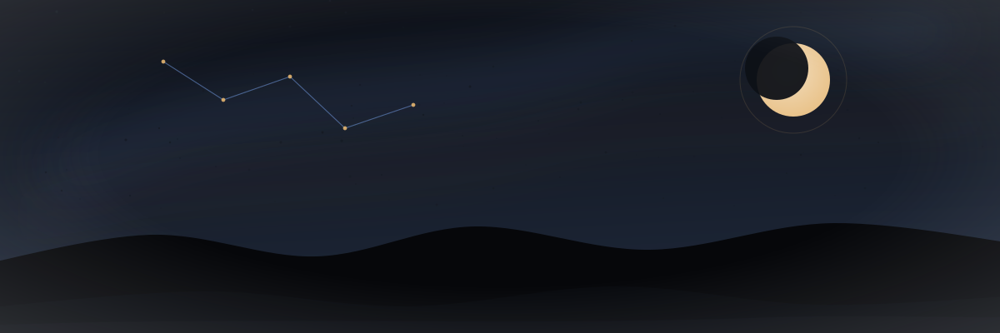

# 墨夜 · 深蓝

> 把灯关掉，只留屏幕这一池深蓝。

*星轨、月牙与看不见的海*

## 这套主题

- 深蓝夜底，长时间阅读也不刺眼
- 强调色是抬亮的雾蓝，副色取一点星金
- 代码高亮按深色底重配过，关键字不会糊成一团

主色 `#7aa7f2` · 副色 `#e3b46e` · 深色

- [x] 换一套配色，界面像换了一间屋子
- [ ] 想把哪一处颜色再挪一挪，去「主题工作室 → 组件颜色」

> 夜越深，字越清楚。
