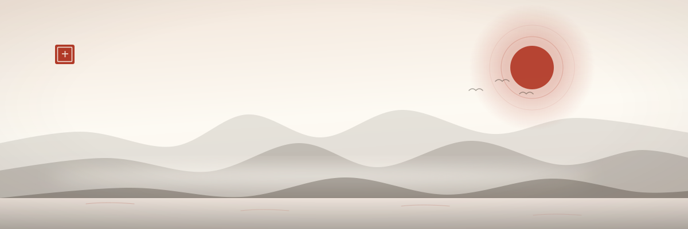

# 宣纸 · 朱砂

> 一张纸，一点朱砂，字迹会自己安静下来。

*远山、印章与一点朱砂*

## 这套主题

- 暖白纸面配朱砂重音，长文读久了也不刺眼
- 朱砂只出现在按钮、链接和选中的地方
- 圆角收得很小、边线很细，像手工裁过的书页

主色 `#b23a28` · 副色 `#a87f3c` · 浅色

- [x] 换一套配色，界面像换了一间屋子
- [ ] 想把哪一处颜色再挪一挪，去「主题工作室 → 组件颜色」

> 写完一段，把笔搁下，纸会替你记住停顿。
