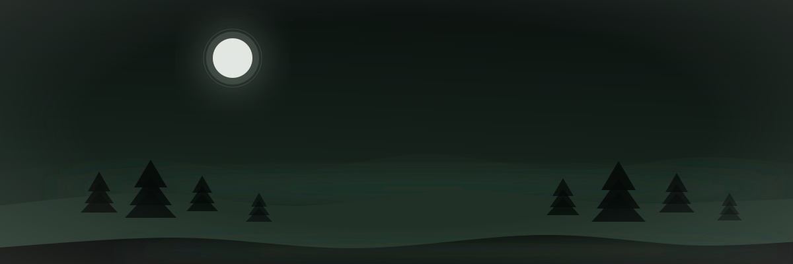

# 松烟 · 青苔

> 墨是松烟烧的，底色带一点青苔的绿。

*松林、山脊与未散的雾*

## 这套主题

- 墨绿夜底比纯黑柔和，边角不显脏
- 强调色是苔痕绿，副色是一点旧纸黄
- 线条细、圆角小，界面靠结构说话

主色 `#86c9a0` · 副色 `#d8b97a` · 深色

- [x] 换一套配色，界面像换了一间屋子
- [ ] 想把哪一处颜色再挪一挪，去「主题工作室 → 组件颜色」

> 山里的夜，只听得见翻页。
