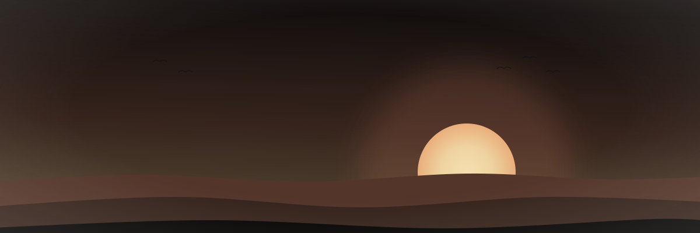

# 落霞 · 陶土

> 晚霞沉下去，陶土还留着余温。

*落日、沙丘与飞过的鸟*

## 这套主题

- 暖褐夜底配陶土橙，写到深夜也不觉得冷
- 副色是晒过的沙金，用来收边和点缀
- 阴影偏暖，代码块像一块烧过的陶片

主色 `#ea8f6d` · 副色 `#e9c886` · 深色

- [x] 换一套配色，界面像换了一间屋子
- [ ] 想把哪一处颜色再挪一挪，去「主题工作室 → 组件颜色」

> 火熄了以后，颜色才开始说话。
